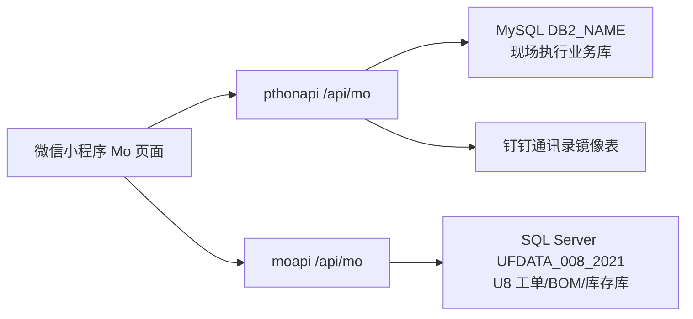
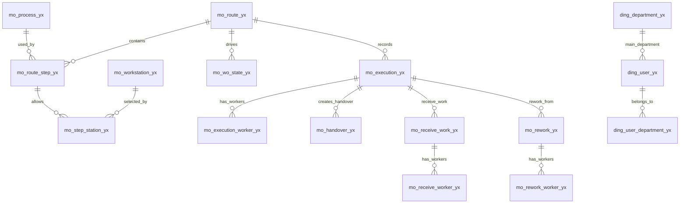

# Mo 现场管理模块数据表说明

本文档说明 `Mo` 现场管理/工序流转模块涉及的数据库、数据表、字段含义、业务作用和接口使用位置。

## 1. 数据库总览

| 数据库/连接 | 类型 | 配置/代码位置 | 主要作用 | 读写方式 |
|---|---|---|---|---|
| `DB2_NAME` | MySQL | `pthonapi/models/db2.py` | Mo 现场管理业务库，保存工序、路线、工站、执行、交接、接收、返工、钉钉人员镜像等数据 | 由 `pthonapi/routes/mo.py` 读写 |
| `DB_NAME` | MySQL | `pthonapi/models/db.py` | 项目通用业务库，Mo 模块当前主要逻辑不直接使用 | 其他 Flask 路由使用 |
| `UFDATA_008_2021` | SQL Server | `moapi/main.py` | U8 工单、物料、部门、BOM、库存成本等主数据来源 | 由 `moapi/main.py` 只读查询 |

## 2. 模块数据流



核心流程：

1. 小程序从 `moapi` 读取 U8 工单列表、工单详情和子件清单。
2. 小程序从 `pthonapi` 读取工艺路线、当前执行状态、人员、历史记录。
3. 开工、完工、接收、返工等动作写入 MySQL 业务库。
4. U8 表作为主数据来源，当前代码中主要是查询，不在小程序流程里写回 U8。

## 3. 表关系总览



## 4. MySQL 业务库表

### 4.1 `mo_menu_yx`：现场管理菜单表

所属数据库：`DB2_NAME`

作用：控制 `Mo/Mo` 入口页展示哪些子功能菜单。当前初始化数据包含“工序管理”，路径为 `/Mo/ProcessMgmt/Index`。

主要使用位置：

| 接口 | 操作 |
|---|---|
| `GET /api/mo/menu` | 查询启用菜单 |

字段说明：

| 字段 | 类型 | 说明 |
|---|---|---|
| `id` | int | 主键，自增 |
| `menu_name` | varchar(50) | 菜单名称 |
| `menu_key` | varchar(50) | 菜单唯一标识，唯一键 |
| `path` | varchar(200) | 小程序页面路径 |
| `emoji` | varchar(200) | 图标 URL；字段名叫 emoji，但实际存图片地址 |
| `description` | varchar(200) | 功能描述 |
| `sort` | int | 排序权重，越小越靠前 |
| `is_active` | tinyint | 是否启用，1 启用，0 禁用 |
| `create_time` | datetime | 创建时间 |
| `update_time` | datetime | 更新时间 |

### 4.2 `mo_process_yx`：工序定义表

所属数据库：`DB2_NAME`

作用：维护工序基础资料，例如压贴、裁切、包装等。路线步骤通过 `process_id` 引用此表。

主要使用位置：

| 接口 | 操作 |
|---|---|
| `GET /api/mo/process/list` | 查询工序列表 |
| `GET /api/mo/process/detail` | 查询工序详情 |
| `POST /api/mo/process/add` | 新增工序 |
| `POST /api/mo/process/update` | 编辑工序 |
| `POST /api/mo/process/toggle` | 启用/停用工序 |
| 路线、状态、历史接口 | 关联获取工序名称 |

字段说明：

| 字段 | 类型 | 说明 |
|---|---|---|
| `id` | int | 主键，自增 |
| `process_code` | varchar(50) | 工序编码，唯一 |
| `process_name` | varchar(100) | 工序名称 |
| `description` | varchar(200) | 备注 |
| `sort` | int | 排序 |
| `is_active` | tinyint | 是否启用 |
| `create_time` | datetime | 创建时间 |
| `update_time` | datetime | 更新时间 |

### 4.3 `mo_workstation_yx`：工站定义表

所属数据库：`DB2_NAME`

作用：维护实际生产工站。某个路线步骤可以允许多个工站，开工时如果有多个工站，前端要求选择。

主要使用位置：

| 接口 | 操作 |
|---|---|
| `GET /api/mo/workstation/list` | 查询工站 |
| `POST /api/mo/workstation/add` | 新增工站 |
| `POST /api/mo/workstation/update` | 编辑工站 |
| `POST /api/mo/workstation/toggle` | 启用/停用工站 |
| `POST /api/mo/start` | 开工时记录实际工站 |

字段说明：

| 字段 | 类型 | 说明 |
|---|---|---|
| `id` | int | 主键，自增 |
| `station_code` | varchar(50) | 工站编码，唯一 |
| `station_name` | varchar(100) | 工站名称 |
| `description` | varchar(200) | 备注 |
| `is_active` | tinyint | 是否启用 |
| `create_time` | datetime | 创建时间 |
| `update_time` | datetime | 更新时间 |

### 4.4 `mo_route_yx`：工艺路线表

所属数据库：`DB2_NAME`

作用：定义一条生产路线，路线下面包含多个有序步骤。路线可绑定 U8 部门，也可作为某个产品类别的默认工艺路线。

主要使用位置：

| 接口 | 操作 |
|---|---|
| 路线管理接口 | 新增、编辑、启用、删除路线 |
| `GET /api/mo/route/detail` | 查询路线及步骤 |
| `GET /api/mo/wo-status` | 判断工单应走哪条路线 |
| `POST /api/mo/start` | 开工时写入路线状态 |
| `POST /api/mo/wo-route/bind` | 显式绑定工单路线 |

字段说明：

| 字段 | 类型 | 说明 |
|---|---|---|
| `id` | int | 主键，自增 |
| `route_code` | varchar(50) | 路线编码，唯一 |
| `route_name` | varchar(100) | 路线名称 |
| `dept_code` | varchar(50) | 匹配 U8 部门编码 |
| `dept_name` | varchar(100) | 部门名称 |
| `is_default` | tinyint | 是否为该部门默认路线 |
| `description` | varchar(200) | 备注 |
| `is_active` | tinyint | 是否启用 |
| `create_time` | datetime | 创建时间 |
| `update_time` | datetime | 更新时间 |

### 4.5 `mo_route_step_yx`：路线步骤表

所属数据库：`DB2_NAME`

作用：定义路线中的第几步是什么工序。一条路线有多条步骤，`seq` 从 1 开始。

主要使用位置：

| 接口 | 操作 |
|---|---|
| `GET /api/mo/wo-status` | 获取当前步骤和下一步骤 |
| `POST /api/mo/start` | 判断当前应开工步骤 |
| `POST /api/mo/complete` | 判断是否还有下一步骤 |
| 路线管理接口 | 保存路线步骤 |

字段说明：

| 字段 | 类型 | 说明 |
|---|---|---|
| `id` | int | 主键，自增 |
| `route_id` | int | 所属路线 ID |
| `seq` | int | 步骤顺序 |
| `process_id` | int | 工序 ID，关联 `mo_process_yx.id` |

约束：`route_id + seq` 唯一，保证同一路线中步骤号不重复。

### 4.6 `mo_step_station_yx`：步骤允许工站表

所属数据库：`DB2_NAME`

作用：维护某个路线步骤允许在哪些工站执行。一个步骤可以配置多个工站。

主要使用位置：

| 接口 | 操作 |
|---|---|
| `GET /api/mo/wo-status` | 返回当前步骤可选工站 |
| 路线管理接口 | 保存步骤工站配置 |

字段说明：

| 字段 | 类型 | 说明 |
|---|---|---|
| `id` | int | 主键，自增 |
| `step_id` | int | 路线步骤 ID，关联 `mo_route_step_yx.id` |
| `station_id` | int | 工站 ID，关联 `mo_workstation_yx.id` |

约束：`step_id + station_id` 唯一。

### 4.7 `mo_product_route_yx`：产品类别路线映射表

所属数据库：`DB2_NAME`

作用：把产品类别绑定到生产工艺路线。产品类别来自 `bj_product_cost_yx`，路线来自 `mo_route_yx`。工单没有显式路线时，会按产品类别匹配路线。

主要使用位置：

| 接口/逻辑 | 操作 |
|---|---|
| `_find_route()` | 按产品类别查找路线 |
| 路线保存接口 | 保存路线与产品类别关系 |

字段说明：

| 字段 | 类型 | 说明 |
|---|---|---|
| `product_code` | varchar(8) | 产品类别编码，主键 |
| `route_id` | int | 路线 ID |
| `create_time` | datetime | 创建时间 |
| `update_time` | datetime | 更新时间 |

### 4.8 `mo_wo_route_yx`：工单路线绑定表

所属数据库：`DB2_NAME`

作用：给具体工单行指定路线。优先级高于已开工状态记录和产品类别默认路线。

路线判断优先级：

1. `mo_wo_route_yx` 显式绑定。
2. `mo_wo_state_yx` 已有状态记录中的 `route_id`。
3. `mo_product_route_yx` 按产品类别匹配。

主要使用位置：

| 接口/逻辑 | 操作 |
|---|---|
| `_find_route()` | 优先查询工单绑定路线 |
| `GET /api/mo/wo-route/list` | 查询绑定 |
| `POST /api/mo/wo-route/bind` | 保存绑定 |

字段说明：

| 字段 | 类型 | 说明 |
|---|---|---|
| `id` | int | 主键，自增 |
| `mo_code` | varchar(50) | 工单号 |
| `sort_seq` | int | 工单行号 |
| `route_id` | int | 指定路线 ID |
| `remark` | varchar(200) | 备注 |
| `create_time` | datetime | 创建时间 |

约束：`mo_code + sort_seq` 唯一。

### 4.9 `mo_wo_state_yx`：工单当前执行状态表

所属数据库：`DB2_NAME`

作用：保存每个工单行当前执行到第几步、当前状态是什么。小程序列表和详情页用它判断“待开工、进行中、待接收、已完成”。

主要使用位置：

| 接口 | 操作 |
|---|---|
| `GET /api/mo/wo-status` | 查询单个工单状态 |
| `POST /api/mo/wo-status-batch` | 批量查询工单状态 |
| `POST /api/mo/start` | 开工时写入/更新为 processing |
| `POST /api/mo/complete` | 完工后推进步骤或置为 done |

字段说明：

| 字段 | 类型 | 说明 |
|---|---|---|
| `mo_code` | varchar(50) | 工单号，联合主键 |
| `sort_seq` | int | 工单行号，联合主键 |
| `route_id` | int | 当前路线 ID |
| `current_seq` | int | 当前步骤序号 |
| `status` | varchar(20) | `pending` 待开工，`processing` 进行中，`done` 已完成 |
| `update_time` | datetime | 更新时间 |

### 4.10 `mo_execution_yx`：工序执行记录表

所属数据库：`DB2_NAME`

作用：记录某个工单行在某条路线某个步骤上的开工、完工、数量、人员操作、照片和状态。它是 Mo 模块最核心的流水表。

主要使用位置：

| 接口 | 操作 |
|---|---|
| `POST /api/mo/start` | 插入执行记录 |
| `POST /api/mo/complete` | 更新完工数量、结束时间、状态 |
| `GET /api/mo/execution/detail` | 查询历史完工记录 |
| `GET /api/mo/my-records` | 查询我的开工/完工记录 |
| 接收、返工接口 | 作为来源执行记录 |

字段说明：

| 字段 | 类型 | 说明 |
|---|---|---|
| `id` | int | 主键，自增 |
| `mo_code` | varchar(50) | 工单号 |
| `sort_seq` | int | 工单行号 |
| `route_id` | int | 路线 ID |
| `seq` | int | 步骤序号 |
| `process_id` | int | 工序 ID |
| `station_id` | int | 实际执行工站 ID |
| `process_name` | varchar(100) | 工序名称快照，避免路线改名影响历史 |
| `station_name` | varchar(100) | 工站名称快照 |
| `operator_id` | varchar(50) | 操作人 ID，来自小程序登录用户 |
| `operator_name` | varchar(100) | 操作人姓名快照 |
| `start_photo_url` | varchar(1000) | 开工主材照片 URL |
| `qty_done` | decimal(18,4) | 完工总数 |
| `qty_a` | decimal(18,4) | A 级数量，补丁/接口中使用 |
| `qty_c` | decimal(18,4) | C 级数量，补丁/接口中使用 |
| `qty_defect` | decimal(18,4) | 不良数量，旧字段/兼容字段 |
| `complete_reason` | varchar(200) | 完工数量与参考值不一致时的说明 |
| `defect_reason` | varchar(200) | 不良原因，旧字段/兼容字段 |
| `start_time` | datetime | 开工时间 |
| `end_time` | datetime | 完工时间 |
| `status` | varchar(20) | `processing` 进行中，`done` 已完成，`interrupted` 中断 |
| `interrupt_reason` | varchar(100) | 中断原因 |
| `interrupt_time` | datetime | 中断时间 |
| `create_time` | datetime | 创建时间 |
| `update_time` | datetime | 更新时间 |

说明：`mo_v2.sql` 中原始表没有 `qty_a`、`qty_c` 字段，但 `pthonapi/routes/mo.py` 和后续接收/返工逻辑已经使用 A/C 级数量。实际库应已通过后续补丁补齐；维护表结构时需要核对线上库字段。

约束：`mo_code + sort_seq + route_id + seq` 唯一，表示一个工单行在同一路线同一步骤只保留一条主执行记录。

拼皮线自动补录规则：生产现场看板先查本表及 `mo_handover_yx`，已有人工记录时不写入。仅ERP生产部门名称精确等于“拼皮线”、已绑定单工序路线且YX_TEST存在裁切记录时，才用首个裁切时间建立系统执行记录；已审核产成品入库累计量写入 `qty_done/qty_a`，A1/A2/C均为0，最后入库审核时间写入 `end_time`。对应批次写入 `mo_execution_completion_yx`，来源在 `mo_operation_log_yx` 中使用 `panel-sync:*` 唯一标识；检测到非系统完工批次后停止自动更新。该规则只写DB2报工表，不修改ERP和YX_TEST。

### 4.11 `mo_execution_worker_yx`：工序执行人员快照表

所属数据库：`DB2_NAME`

作用：记录某次开工选择了哪些正式员工。员工姓名、手机号、部门路径都做快照，避免钉钉通讯录变化后历史记录失真。

主要使用位置：

| 接口 | 操作 |
|---|---|
| `POST /api/mo/start` | 插入开工人员 |
| `GET /api/mo/wo-status` | 展示进行中人员 |
| `GET /api/mo/execution/detail` | 展示历史人员 |

字段说明：

| 字段 | 类型 | 说明 |
|---|---|---|
| `id` | bigint | 主键，自增 |
| `execution_id` | bigint | 执行记录 ID，关联 `mo_execution_yx.id` |
| `ding_user_id` | varchar(100) | 钉钉 userId |
| `user_name_snapshot` | varchar(100) | 人员姓名快照 |
| `mobile_snapshot` | varchar(30) | 手机号快照 |
| `dept_id_snapshot` | bigint | 主部门 ID 快照 |
| `dept_path_snapshot` | varchar(1000) | 部门路径快照 |
| `create_time` | datetime | 创建时间 |

约束：`execution_id + ding_user_id` 唯一。

### 4.12 `mo_handover_yx`：工序交接记录表

所属数据库：`DB2_NAME`

作用：上一道工序完工后生成交接记录，下一道工序接收后确认。它连接“完工数量”和“下工序接收数量”。

主要使用位置：

| 接口 | 操作 |
|---|---|
| `POST /api/mo/complete` | 非最后一道工序完工后生成交接记录 |
| `GET /api/mo/wo-status` | 判断是否待接收 |
| `POST /api/mo/receive` | 普通接收确认 |
| `POST /api/mo/receive-work/start` | 接收作业开工 |
| `POST /api/mo/receive-work/complete` | 接收作业完工后累计数量 |
| 返工完工接口 | 返工后可能追加交出数量 |

字段说明：

| 字段 | 类型 | 说明 |
|---|---|---|
| `id` | int | 主键，自增 |
| `mo_code` | varchar(50) | 工单号 |
| `sort_seq` | int | 工单行号 |
| `route_id` | int | 路线 ID |
| `from_seq` | int | 交出步骤序号 |
| `to_seq` | int | 接收步骤序号 |
| `from_station_id` | int | 交出工站 ID |
| `to_station_id` | int | 接收工站 ID |
| `qty_out` | decimal(18,4) | 上工序交出数量 |
| `qty_in` | decimal(18,4) | 下工序已接收数量 |
| `receipt_reason` | varchar(200) | 接收数量与交出数量不一致时的说明 |
| `operator_out` | varchar(100) | 交出操作人 |
| `operator_in` | varchar(100) | 接收操作人 |
| `status` | varchar(20) | `pending` 待接收，`confirmed` 已确认 |
| `create_time` | datetime | 创建时间 |
| `confirm_time` | datetime | 确认时间 |

约束：补丁中增加 `mo_code + sort_seq + from_seq + to_seq` 唯一，避免同一步骤重复生成交接。

### 4.13 `mo_makeup_record_yx`：追加接收/补接收流水表

所属数据库：`DB2_NAME`

作用：记录每次接收数量累计变化。普通接收、接收作业完工等都会写流水，用于历史中展示“接收流水”。

主要使用位置：

| 接口 | 操作 |
|---|---|
| `POST /api/mo/receive` | 写入接收流水 |
| `POST /api/mo/receive-work/complete` | 接收作业完工后写入流水 |
| `GET /api/mo/execution/detail` | 查询接收流水 |

字段说明：

| 字段 | 类型 | 说明 |
|---|---|---|
| `id` | bigint | 主键，自增 |
| `execution_id` | bigint | 当前执行记录 ID |
| `mo_code` | varchar(50) | 工单号 |
| `sort_seq` | int | 工单行号 |
| `seq` | int | 步骤序号 |
| `qty_before` | decimal(18,4) | 本次接收前累计数量 |
| `qty_add` | decimal(18,4) | 本次新增接收数量 |
| `qty_after` | decimal(18,4) | 本次接收后累计数量 |
| `plan_qty` | decimal(18,4) | 参考/计划数量 |
| `reason` | varchar(500) | 超出或不足说明 |
| `operator_id` | varchar(50) | 操作人 ID |
| `operator_name` | varchar(100) | 操作人姓名 |
| `create_time` | datetime | 创建时间 |

### 4.14 `mo_receive_work_yx`：接收作业记录表

所属数据库：`DB2_NAME`

作用：用于“接收也需要开工/完工”的场景。接收开始时记录投入数量、人员、照片；接收完工时录入 A/C 级数量。

主要使用位置：

| 接口 | 操作 |
|---|---|
| `POST /api/mo/receive-work/start` | 开始接收作业 |
| `POST /api/mo/receive-work/complete` | 接收作业完工 |
| `GET /api/mo/execution/detail` | 展示接收作业记录 |

字段说明：

| 字段 | 类型 | 说明 |
|---|---|---|
| `id` | bigint | 主键，自增 |
| `execution_id` | bigint | 当前工序完工执行记录 ID |
| `handover_id` | bigint | 对应交接单 ID |
| `mo_code` | varchar(50) | 工单号 |
| `sort_seq` | int | 工单行号 |
| `route_id` | int | 路线 ID |
| `seq` | int | 步骤序号 |
| `process_name` | varchar(100) | 工序名称快照 |
| `qty_input` | decimal(18,4) | 本次接收投入数量 |
| `qty_a` | decimal(18,4) | 接收完工 A 级数量 |
| `qty_c` | decimal(18,4) | 接收完工 C 级数量 |
| `qty_before` | decimal(18,4) | 开始接收前已接收数量 |
| `qty_ref` | decimal(18,4) | 上工序完工数量 |
| `reason` | varchar(500) | 超出说明或备注 |
| `photo_url` | varchar(1000) | 接收领用照片 URL |
| `operator_id` | varchar(50) | 操作人 ID |
| `operator_name` | varchar(100) | 操作人姓名 |
| `status` | varchar(20) | `processing` 进行中，`done` 已完成 |
| `start_time` | datetime | 开始时间 |
| `end_time` | datetime | 完成时间 |
| `create_time` | datetime | 创建时间 |
| `update_time` | datetime | 更新时间 |

### 4.15 `mo_receive_worker_yx`：接收作业人员快照表

所属数据库：`DB2_NAME`

作用：记录某次接收作业选择的正式员工快照。

主要使用位置：

| 接口 | 操作 |
|---|---|
| `POST /api/mo/receive-work/start` | 插入接收人员 |
| `GET /api/mo/execution/detail` | 查询接收人员 |

字段说明：

| 字段 | 类型 | 说明 |
|---|---|---|
| `id` | bigint | 主键，自增 |
| `receive_id` | bigint | 接收作业 ID，关联 `mo_receive_work_yx.id` |
| `ding_user_id` | varchar(100) | 钉钉 userId |
| `user_name_snapshot` | varchar(100) | 姓名快照 |
| `mobile_snapshot` | varchar(30) | 手机号快照 |
| `dept_id_snapshot` | bigint | 部门 ID 快照 |
| `dept_path_snapshot` | varchar(1000) | 部门路径快照 |
| `create_time` | datetime | 创建时间 |

### 4.16 `mo_rework_yx`：C 级品返工记录表

所属数据库：`DB2_NAME`

作用：记录某次完工产生的 C 级品返工过程。返工开始时投入 C 级数量，返工完工时录入返工后的 A/C 级数量。

主要使用位置：

| 接口 | 操作 |
|---|---|
| `POST /api/mo/rework/start` | 开始返工 |
| `POST /api/mo/rework/complete` | 返工完工 |
| `GET /api/mo/execution/detail` | 展示返工记录 |

字段说明：

| 字段 | 类型 | 说明 |
|---|---|---|
| `id` | bigint | 主键，自增 |
| `source_execution_id` | bigint | 原完工执行记录 ID |
| `mo_code` | varchar(50) | 工单号 |
| `sort_seq` | int | 工单行号 |
| `route_id` | int | 路线 ID |
| `seq` | int | 步骤序号 |
| `process_name` | varchar(100) | 工序名称快照 |
| `qty_input` | decimal(18,4) | 投入返工的 C 级数量 |
| `qty_a` | decimal(18,4) | 返工后 A 级数量 |
| `qty_c` | decimal(18,4) | 返工后仍为 C 级数量 |
| `reason` | varchar(500) | 返工原因 |
| `complete_remark` | varchar(500) | 返工完工备注 |
| `operator_id` | varchar(50) | 操作人 ID |
| `operator_name` | varchar(100) | 操作人姓名 |
| `status` | varchar(20) | `processing` 进行中，`done` 已完成 |
| `start_time` | datetime | 开始时间 |
| `end_time` | datetime | 完成时间 |
| `create_time` | datetime | 创建时间 |
| `update_time` | datetime | 更新时间 |

### 4.17 `mo_rework_worker_yx`：返工人员快照表

所属数据库：`DB2_NAME`

作用：记录某次返工作业选择的正式员工快照。

主要使用位置：

| 接口 | 操作 |
|---|---|
| `POST /api/mo/rework/start` | 插入返工人员 |
| `GET /api/mo/execution/detail` | 查询返工人员 |

字段说明：

| 字段 | 类型 | 说明 |
|---|---|---|
| `id` | bigint | 主键，自增 |
| `rework_id` | bigint | 返工记录 ID，关联 `mo_rework_yx.id` |
| `ding_user_id` | varchar(100) | 钉钉 userId |
| `user_name_snapshot` | varchar(100) | 姓名快照 |
| `mobile_snapshot` | varchar(30) | 手机号快照 |
| `dept_id_snapshot` | bigint | 部门 ID 快照 |
| `dept_path_snapshot` | varchar(1000) | 部门路径快照 |
| `create_time` | datetime | 创建时间 |

### 4.18 `mo_workorder_context_yx`：工单产品及客户上下文表

所属数据库：`DB2_NAME`

作用：缓存ERP工单的产品、销售来源和客户资料，供报工记录、报表及看板在ERP暂不可用或工单已关闭后继续展示。主键为 `mo_code + sort_seq`。

字段说明：

| 字段 | 类型 | 说明 |
|---|---|---|
| `mo_code` | varchar(50) | 生产订单号 |
| `sort_seq` | int | 生产订单行号 |
| `inv_code` | varchar(100) | 产品编码 |
| `inv_name` | varchar(255) | 产品名称 |
| `inv_std` | varchar(255) | 规格型号 |
| `plan_qty` | decimal(18,4) | 计划生产数量 |
| `so_code_008` | varchar(60) | 008销售订单号 |
| `so_row_008` | int | 008销售订单行号 |
| `source_account` | varchar(10) | 来源账套，如 `001`、`002`、`008` |
| `source_so_code` | varchar(60) | 来源销售订单号 |
| `source_so_row` | int | 来源销售订单行号，预留 |
| `customer_code` | varchar(60) | 客户编码 |
| `customer_name` | varchar(255) | 客户名称 |
| `sync_time` | datetime | 最近同步时间 |

同步与读取规则：

- PythonAPI读取工单详情时异步补充该表；历史数据也可通过专用同步脚本回填，写入失败不阻断现场报工。
- Web生产现场看板先读取U8实时产品资料，再读取本表；对于ERP开放但尚未报工、本表没有记录的工单，继续从MOAPI开放工单列表补齐008销售单、来源账套、来源销售单及客户。
- 小程序生产现场看板同样以本表为缓存，并用MOAPI开放工单列表补充未报工工单的实时客户；实时返回为空时才保留缓存客户。
- 缺少本表记录不代表没有客户，也不能据此把工单判断为已删除或已关闭。

## 5. 钉钉通讯录镜像表

这些表属于 `DB2_NAME`，用于小程序选择开工、接收、返工人员。同步逻辑在 `pthonapi/services/dingtalk_sync.py` 和相关脚本中。

### 5.1 `ding_department_yx`：钉钉部门镜像表

| 字段 | 类型 | 说明 |
|---|---|---|
| `dept_id` | bigint | 钉钉部门 ID，主键 |
| `parent_dept_id` | bigint | 上级部门 ID |
| `dept_name` | varchar(200) | 部门名称 |
| `dept_level` | int | 部门层级 |
| `dept_path` | varchar(1000) | 部门完整路径 |
| `sort_order` | bigint | 钉钉排序值 |
| `is_active` | tinyint | 是否有效 |
| `last_seen_sync` | varchar(36) | 最近一次同步批次 |
| `create_time` | datetime | 创建时间 |
| `update_time` | datetime | 更新时间 |

### 5.2 `ding_user_yx`：钉钉用户镜像表

| 字段 | 类型 | 说明 |
|---|---|---|
| `user_id` | varchar(100) | 钉钉 userId，主键 |
| `union_id` | varchar(100) | 钉钉 unionId |
| `user_name` | varchar(100) | 用户姓名 |
| `mobile` | varchar(30) | 手机号 |
| `job_number` | varchar(100) | 工号 |
| `title` | varchar(100) | 职位 |
| `main_dept_id` | bigint | 主部门 ID |
| `is_admin` | tinyint | 是否管理员 |
| `is_boss` | tinyint | 是否老板 |
| `is_active` | tinyint | 是否有效 |
| `last_seen_sync` | varchar(36) | 最近一次同步批次 |
| `create_time` | datetime | 创建时间 |
| `update_time` | datetime | 更新时间 |

### 5.3 `ding_user_department_yx`：钉钉用户部门关系表

| 字段 | 类型 | 说明 |
|---|---|---|
| `user_id` | varchar(100) | 钉钉 userId |
| `dept_id` | bigint | 部门 ID |
| `is_leader` | tinyint | 是否部门负责人 |
| `create_time` | datetime | 创建时间 |

主键：`user_id + dept_id`。

### 5.4 `ding_sync_log_yx`：钉钉同步日志表

| 字段 | 类型 | 说明 |
|---|---|---|
| `id` | bigint | 主键，自增 |
| `sync_id` | varchar(36) | 同步批次 ID |
| `trigger_type` | varchar(20) | 触发类型，`cron` 定时或 `manual` 手动 |
| `status` | varchar(20) | `running`、`success`、`failed` |
| `department_count` | int | 同步部门数 |
| `user_count` | int | 同步用户数 |
| `disabled_depts` | int | 本次置为无效的部门数 |
| `disabled_users` | int | 本次置为无效的用户数 |
| `error_message` | varchar(1000) | 错误信息 |
| `start_time` | datetime | 开始时间 |
| `end_time` | datetime | 结束时间 |

## 6. 其他 MySQL 关联表

### 6.1 `bj_product_cost_yx`：产品类别表

所属数据库：`DB2_NAME`

作用：在 Mo 模块中用于把 U8 物料档案里的产品类别名称匹配到内部产品类别编码，再通过 `mo_product_route_yx` 找到生产路线。

主要使用位置：

| 位置 | 作用 |
|---|---|
| `_find_route()` | `TRIM(pc.name)=TRIM(category_name)` 匹配产品类别 |
| 路线产品映射接口 | 查询可绑定产品类别 |

Mo 模块用到的字段：

| 字段 | 说明 |
|---|---|
| `code` | 产品类别编码 |
| `name` | 产品类别名称 |
| `is_enabled` | 是否启用 |

### 6.2 `jml_staff`：系统员工表

所属数据库：`DB2_NAME`

作用：把小程序登录用户 ID 转换为操作人姓名，用于写入执行、接收、返工等记录的 `operator_name`。

主要使用位置：

| 位置 | 作用 |
|---|---|
| `_get_operator()` | 根据 `id` 查询 `name` |

Mo 模块用到的字段：

| 字段 | 说明 |
|---|---|
| `id` | 员工 ID |
| `name` | 员工姓名 |

## 7. SQL Server / U8 主数据表

这些表来自 `moapi/main.py`，连接数据库为 `UFDATA_008_2021`。当前 Mo 小程序主要读取这些数据，不直接修改。

### 7.1 `momlist_yx`：U8 生产工单明细视图/表

作用：提供已释放、未关闭的生产工单行。小程序列表和详情页都从这里获取工单号、行号、部门、产品、计划数量、开工/到期日期等。

主要使用位置：

| 接口 | 操作 |
|---|---|
| `GET /api/mo/workorder/list` | 查询工单列表 |
| `GET /api/mo/workorder/detail` | 查询工单详情 |

Mo 模块用到的字段：

| 字段 | 说明 |
|---|---|
| `MoCode_a` | 工单号 |
| `SortSeq_b` | 工单行号 |
| `MDeptCode_b` | 生产部门编码，对应 `Department.cDepCode` |
| `InvCode_b` | 母件/产品物料编码 |
| `Qty_b` | 计划生产数量 |
| `MoDId_b` | 工单明细 ID，用于关联子件领料 |
| `StartDate_c` | 开工日期 |
| `DueDate_c` | 到期日期 |
| `RelsDate_b` | 释放日期，非空表示已释放 |
| `CloseDate_b` | 关闭日期，空表示未关闭 |

筛选逻辑：

```sql
WHERE RelsDate_b IS NOT NULL
  AND CloseDate_b IS NULL
```

计划日期及原值读取规则：

- 当前计划开工、计划完工仍取 `momlist_yx.StartDate_c`、`momlist_yx.DueDate_c`，其来源是U8 `dbo.mom_morder.StartDate`、`DueDate`。
- U8现有触发器 `dbo.trgAfterupdateOnmom_morder` 名称虽含“update”，实际定义为 `AFTER INSERT`；新建工单时会把 `MoDId`、`StartDate`、`DueDate`、`MoId` 写入 `YX_TEST.dbo.mom_morder`，并标记 `zt='008'`。它不是每次修改日期都追加历史的更新触发器。
- 生产现场看板把 `YX_TEST.dbo.mom_morder` 作为初始日期快照。同一 `MoDId` 可能存在重复记录，读取时限定 `zt='008'`，按空 `UpdateTime` 优先、随后 `UpdateTime` 升序取第一条；只在原日期与当前日期不同时显示灰色原值。
- 本方案不新增表或触发器。2026-10-28只读核对57个开放工单行均有快照，其中39行至少一个当前日期与最早快照不同。

### 7.2 `Inventory`：U8 存货档案表

作用：获取母件和子件名称、产品类别等物料资料。

主要使用位置：

| 接口 | 操作 |
|---|---|
| `GET /api/mo/workorder/list` | 获取母件名称和产品类别 |
| `GET /api/mo/workorder/detail` | 获取母件、子件名称 |

Mo 模块用到的字段：

| 字段 | 说明 |
|---|---|
| `cInvCode` | 物料编码 |
| `cInvName` | 物料名称 |
| `cInvDefine7` | 产品类别名称；代码中作为 `CategoryName` |

### 7.3 `Department`：U8 部门表

作用：获取生产部门名称，并用于工单部门和工艺路线部门编码匹配。

主要使用位置：

| 接口 | 操作 |
|---|---|
| `GET /api/mo/workorder/list` | 获取部门名称 |
| `GET /api/mo/workorder/detail` | 获取部门名称 |
| `GET /api/mo/departments` | 查询 U8 部门列表 |

Mo 模块用到的字段：

| 字段 | 说明 |
|---|---|
| `cDepCode` | 部门编码 |
| `cDepName` | 部门名称 |

### 7.4 `mom_moallocate`：U8 工单子件/领料表

作用：提供工单需要的子件清单、应领数量、已领数量。工单详情页底部“子件清单”来自此表。

主要使用位置：

| 接口 | 操作 |
|---|---|
| `GET /api/mo/workorder/detail` | 查询子件清单 |

Mo 模块用到的字段：

| 字段 | 说明 |
|---|---|
| `MoDId` | 工单明细 ID，关联 `momlist_yx.MoDId_b` |
| `InvCode` | 子件物料编码 |
| `Qty` | 应领数量，接口返回为 `qty_plan` |
| `IssQty` | 已领数量，接口返回为 `qty_issued` |

### 7.5 `bomdetail_yx`：U8 BOM 明细表

作用：查询某个母件最新 BOM 子件，用于材料成本接口。它不属于 Mo 工序执行主链路，但在 `moapi/main.py` 的 `/api/mo/material/cost` 中使用。

Mo 模块用到的字段：

| 字段 | 说明 |
|---|---|
| `minvcode` | 母件编码 |
| `zinvcode` | 子件编码 |
| `BaseQtyN / BaseQtyD` | 子件用量 |
| `compscrap` | 损耗率 |
| `BomId` | BOM 版本 ID |
| `RelsDate` | 发布日期 |

### 7.6 `IA_Subsidiary`：U8 存货明细账/成本来源表

作用：查询子件最近一次入库成本，用于材料成本估算。

Mo 模块用到的字段：

| 字段 | 说明 |
|---|---|
| `cInvCode` | 物料编码 |
| `iInCost` | 入库单价/成本 |
| `bRdFlag` | 出入库方向，代码中取 `1` |
| `cVouCode` | 单据号 |
| `AutoID` | 自增 ID，代码中按最大值取最近记录 |

## 8. 前端页面与表的对应关系

| 小程序页面 | 主要接口 | 主要涉及表 |
|---|---|---|
| `Mo/Mo` | `/menu` | `mo_menu_yx` |
| `Mo/ProcessMgmt/Scanner` | `/my-records`, `/workorder/list` | `mo_execution_yx`, `mo_execution_worker_yx`, U8 `momlist_yx` |
| `Mo/ProcessMgmt/Index` | `/workorder/list`, `/route/dept-map`, `/wo-status-batch` | U8 `momlist_yx`, `Department`, `mo_wo_state_yx`, `mo_route_yx`, `mo_process_yx` |
| `Mo/ProcessMgmt/Detailed` | `/workorder/detail`, `/wo-status`, `/start`, `/complete`, `/receive`, `/execution/detail`, `/receive-work/*`, `/rework/*` | U8 `momlist_yx`, `Inventory`, `mom_moallocate`, `mo_execution_yx`, `mo_handover_yx`, `mo_receive_work_yx`, `mo_rework_yx` |
| `Mo/ProcessMgmt/Edit` | `/process/detail`, `/process/add`, `/process/update` | `mo_process_yx` |
| `Mo/ProcessMgmt/ProductionBoard` | `/reporting/board` | `mo_workorder_context_yx`、工序执行/交接/返工表、U8开放工单接口 |

## 9. 主要接口与数据表读写关系

| 接口 | 读表 | 写表 | 说明 |
|---|---|---|---|
| `GET /api/mo/menu` | `mo_menu_yx` |  | 查询现场管理菜单 |
| `GET /api/mo/workorder/list` | U8 `momlist_yx`, `Inventory`, `Department` |  | 查询待处理工单 |
| `GET /api/mo/workorder/detail` | U8 `momlist_yx`, `Inventory`, `Department`, `mom_moallocate` |  | 查询工单详情和子件清单 |
| `GET /api/mo/reporting/board` | `mo_workorder_context_yx`、工序执行/交接/返工表、U8开放工单接口 |  | 小程序生产现场看板；包含未报工开放工单并补实时客户 |
| `GET /api/mo/wo-status` | `mo_wo_route_yx`, `mo_wo_state_yx`, `mo_route_step_yx`, `mo_process_yx`, `mo_step_station_yx`, `mo_workstation_yx`, `mo_execution_yx`, `mo_handover_yx` |  | 查询单个工单当前状态 |
| `POST /api/mo/wo-status-batch` | `mo_wo_state_yx`, `mo_route_step_yx`, `mo_process_yx`, `mo_handover_yx` |  | 批量查询列表状态 |
| `POST /api/mo/start` | `mo_wo_state_yx`, `mo_route_step_yx`, `mo_process_yx`, `mo_workstation_yx`, `ding_user_yx` | `mo_execution_yx`, `mo_execution_worker_yx`, `mo_wo_state_yx` | 工序开工 |
| `POST /api/mo/complete` | `mo_execution_yx`, `mo_route_step_yx` | `mo_execution_yx`, `mo_handover_yx`, `mo_wo_state_yx` | 工序完工并推进 |
| `POST /api/mo/receive` | `mo_handover_yx`, `mo_execution_yx` | `mo_handover_yx`, `mo_makeup_record_yx` | 普通接收确认 |
| `GET /api/mo/execution/detail` | `mo_execution_yx`, `mo_execution_worker_yx`, `mo_handover_yx`, `mo_makeup_record_yx`, `mo_receive_work_yx`, `mo_receive_worker_yx`, `mo_rework_yx`, `mo_rework_worker_yx` |  | 完工历史详情 |
| `POST /api/mo/receive-work/start` | `mo_execution_yx`, `mo_handover_yx`, `ding_user_yx` | `mo_receive_work_yx`, `mo_receive_worker_yx` | 接收作业开工 |
| `POST /api/mo/receive-work/complete` | `mo_receive_work_yx`, `mo_handover_yx` | `mo_receive_work_yx`, `mo_handover_yx`, `mo_makeup_record_yx`, `mo_execution_yx` | 接收作业完工 |
| `POST /api/mo/rework/start` | `mo_execution_yx`, `ding_user_yx` | `mo_rework_yx`, `mo_rework_worker_yx` | C 级品返工开始 |
| `POST /api/mo/rework/complete` | `mo_rework_yx`, `mo_execution_yx`, `mo_handover_yx` | `mo_rework_yx`, `mo_execution_yx`, `mo_handover_yx` | C 级品返工完工 |
| `GET /api/mo/dingtalk/departments` | `ding_department_yx` |  | 查询部门树 |
| `GET /api/mo/dingtalk/workers` | `ding_user_yx`, `ding_department_yx`, `ding_user_department_yx` |  | 查询人员 |

## 10. 状态字段约定

| 表 | 字段 | 可见状态 | 说明 |
|---|---|---|---|
| `mo_wo_state_yx` | `status` | `pending` | 当前步骤待开工或待接收 |
| `mo_wo_state_yx` | `status` | `processing` | 当前步骤进行中 |
| `mo_wo_state_yx` | `status` | `done` | 工单路线全部完成 |
| `mo_execution_yx` | `status` | `processing` | 已开工未完工 |
| `mo_execution_yx` | `status` | `done` | 已完工 |
| `mo_execution_yx` | `status` | `interrupted` | 中断，当前前端使用较少 |
| `mo_handover_yx` | `status` | `pending` | 上工序已交出，下工序待接收 |
| `mo_handover_yx` | `status` | `confirmed` | 下工序已接收 |
| `mo_receive_work_yx` | `status` | `processing` | 接收作业进行中 |
| `mo_receive_work_yx` | `status` | `done` | 接收作业完成 |
| `mo_rework_yx` | `status` | `processing` | 返工作业进行中 |
| `mo_rework_yx` | `status` | `done` | 返工作业完成 |

## 11. 注意事项

1. `JML_WX_miniapp` 是 uni-app 编译后的微信小程序产物，数据库和接口的真实维护重点在 `JML_MINIAPP/pthonapi`、`JML_MINIAPP/moapi` 和 `JML_MINIAPP/sql`。
2. `mo_execution_yx` 是核心执行表，很多历史统计、我的记录、接收、返工都依赖它，修改字段时要同步检查 `pthonapi/routes/mo.py`。
3. 人员表采用快照设计，执行、接收、返工记录保存姓名和部门快照，不能只依赖当前钉钉用户表。
4. U8 数据库目前主要只读。工单列表筛选“已释放且未关闭”，如果 U8 关闭逻辑变化，会直接影响小程序待开工列表。
5. 路线匹配存在优先级：工单显式绑定 > 已有工单状态 > 产品类别映射。排查“为什么这个工单走这条路线”时应按这个顺序检查。
6. SQL 文件中存在增量补丁，实际线上表结构应以 `mo_v2.sql` 加全部 `mo_*patch*.sql`、`mo_receive_work_*`、`mo_rework_yx.sql`、`mo_execution_workers.sql` 等执行后的结果为准。
