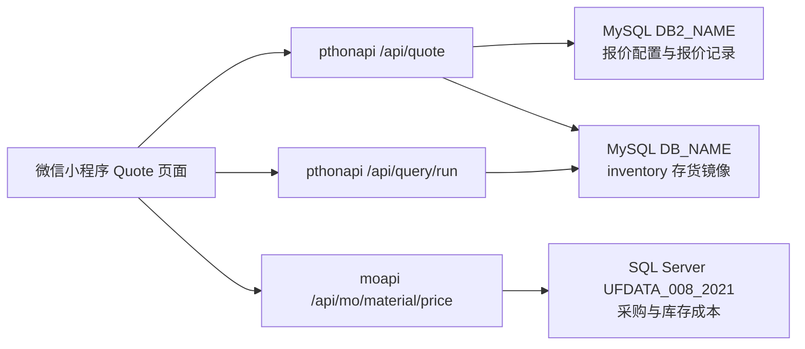
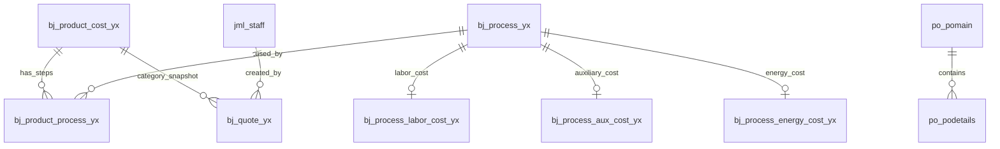

# Quote 报价模块数据表说明

本文档说明 `JML_WX_miniapp/Quote` 报价模块涉及的数据库、数据表、字段含义、业务作用，以及前端页面和后端接口之间的对应关系。

整理依据：

- 小程序页面：`JML_WX_miniapp/Quote`
- 报价后端：`JML_MINIAPP/pthonapi/routes/quote.py`
- 通用查询接口：`JML_MINIAPP/pthonapi/routes/query.py`
- U8 材料价格接口：`JML_MINIAPP/moapi/main.py`
- 报价建表脚本：`JML_MINIAPP/报价工具/sql`

## 1. 数据库总览

| 数据库/连接 | 类型 | 配置/代码位置 | Quote 模块中的主要作用 | 读写方式 |
|---|---|---|---|---|
| `DB2_NAME` | MySQL | `pthonapi/models/db2.py` | 保存产品类别、报价工序、工序成本、公共成本、报价记录及员工资料 | 报价接口读写 |
| `DB_NAME` | MySQL | `pthonapi/models/db.py` | 保存 `inventory` 存货镜像，供产品和材料料号搜索 | 只读查询 |
| `UFDATA_008_2021` | SQL Server | `moapi/main.py` | 查询采购订单价格、木皮最近入库成本 | 只读查询 |

## 2. 模块数据流



核心流程：

1. 新增报价时，从 `bj_product_cost_yx` 读取启用的产品类别。
2. 选择产品类别后，根据产品路线、工序和各类成本表计算人工、辅材、能耗成本。
3. 产品和材料料号从 MySQL 主库的 `inventory` 表搜索。
4. 材料价格从 U8 采购订单或存货明细账读取。
5. 保存报价时，服务端重新计算关键价格，并将完整表单保存到 `bj_quote_yx.form_snapshot`。
6. 报价列表、详情、客户历史均从 `bj_quote_yx` 查询。

## 3. 表关系总览



说明：报价记录保存的是产品类别、路线、成本和人员的快照。即使后续修改成本配置，已保存报价也不会自动跟着变化。

## 4. MySQL 报价业务库 `DB2_NAME`

### 4.1 `bj_product_cost_yx`：产品类别与计算规则表

作用：维护报价产品类型、展示路线、报价单位和管理费用分摊比例。报价新增页的“产品类型”下拉框来自此表。

主要使用位置：

| 接口 | 操作 |
|---|---|
| `GET /api/quote/category/list` | 查询启用的产品类别 |
| `GET /api/quote/cost/calc` | 获取产品路线和管理费用规则 |

字段说明：

| 字段 | 类型 | 说明 |
|---|---|---|
| `id` | int unsigned | 内部主键，自增 |
| `code` | varchar(8) | 产品类别编码，唯一 |
| `name` | varchar(100) | 产品类别名称 |
| `route_desc` | varchar(500) | 完整工艺路线，供报价页面展示 |
| `unit` | varchar(8) | 报价单位，如张、根 |
| `mgmt_rate` | decimal(8,4) | 管理费用分摊比例，如 0、0.25、0.5 |
| `mgmt_method` | varchar(32) | 管理分摊文字说明 |
| `is_enabled` | tinyint | 1 启用，0 停用 |
| `remark` | varchar(255) | 备注 |
| `created_at` | datetime | 创建时间 |
| `updated_at` | datetime | 更新时间 |

### 4.2 `bj_product_process_yx`：产品工序路线表

作用：定义某个产品类别包含哪些报价工序，以及工序的先后顺序。此表用于报价成本计算，不是 Mo 现场报工路线表。

主要使用位置：

| 接口 | 操作 |
|---|---|
| `GET /api/quote/cost/calc` | 按产品类别读取工序步骤 |

字段说明：

| 字段 | 类型 | 说明 |
|---|---|---|
| `id` | int unsigned | 内部主键，自增 |
| `product_code` | varchar(8) | 产品类别编码，对应 `bj_product_cost_yx.code` |
| `seq_no` | int | 报价工序顺序 |
| `process_code` | varchar(8) | 明确指定的工序编码 |
| `process_group` | varchar(32) | 工序分组，与 `process_code` 二选一 |
| `remark` | varchar(255) | 步骤备注；“含覆膜”等规则会读取此字段 |
| `created_at` | datetime | 创建时间 |
| `updated_at` | datetime | 更新时间 |

约束：`product_code + seq_no` 唯一。同一个工序如果需要重复计算，可以使用不同的 `seq_no` 保存多行。

### 4.3 `bj_process_yx`：报价工序主表

作用：维护报价计算使用的工序基础资料和同类工序分组。

主要使用位置：

| 接口 | 操作 |
|---|---|
| `GET /api/quote/cost/calc` | 获取工序名称并关联三类成本 |

字段说明：

| 字段 | 类型 | 说明 |
|---|---|---|
| `id` | int unsigned | 内部主键，自增 |
| `process_code` | varchar(8) | 报价工序编码，唯一 |
| `process_name` | varchar(100) | 工序名称 |
| `process_group` | varchar(32) | 同类工序分组 |
| `unit` | varchar(8) | 成本单位，默认“张” |
| `sort_no` | int | 显示排序 |
| `is_enabled` | tinyint | 是否启用 |
| `remark` | varchar(255) | 备注 |
| `created_at` | datetime | 创建时间 |
| `updated_at` | datetime | 更新时间 |

分组计算规则：如果产品步骤只配置 `process_group`，后端会在该组启用工序中，对人工、辅材、能耗分别选取单位成本最高的方案，不保证三类成本来自同一个工序。

### 4.4 `bj_process_labor_cost_yx`：工序人工成本表

作用：保存每个报价工序的单位人工成本。该金额按未税成本直接计入。

| 字段 | 类型 | 说明 |
|---|---|---|
| `id` | int unsigned | 主键，自增 |
| `process_code` | varchar(8) | 工序编码，唯一 |
| `cost_amount` | decimal(12,4) | 单位人工成本 |
| `is_enabled` | tinyint | 是否启用 |
| `remark` | varchar(255) | 备注 |
| `created_at` | datetime | 创建时间 |
| `updated_at` | datetime | 更新时间 |

### 4.5 `bj_process_aux_cost_yx`：工序辅助材料成本表

作用：保存每个报价工序的单位辅助材料成本。当前表内金额按含税金额维护，报价计算时统一除以 1.13 转为未税成本。

| 字段 | 类型 | 说明 |
|---|---|---|
| `id` | int unsigned | 主键，自增 |
| `process_code` | varchar(8) | 工序编码，唯一 |
| `cost_amount` | decimal(12,4) | 单位辅材含税成本 |
| `is_enabled` | tinyint | 是否启用 |
| `remark` | varchar(255) | 备注 |
| `created_at` | datetime | 创建时间 |
| `updated_at` | datetime | 更新时间 |

特殊规则：路线步骤备注包含“含覆膜”，且路线没有 19 号工序时，后端会自动增加一次 19 号包装材料辅材成本。

### 4.6 `bj_process_energy_cost_yx`：工序能耗成本表

作用：保存每个报价工序的单位能耗成本，按未税成本直接计入。

| 字段 | 类型 | 说明 |
|---|---|---|
| `id` | int unsigned | 主键，自增 |
| `process_code` | varchar(8) | 工序编码，唯一 |
| `cost_amount` | decimal(12,4) | 单位能耗成本 |
| `is_enabled` | tinyint | 是否启用 |
| `remark` | varchar(255) | 备注 |
| `created_at` | datetime | 创建时间 |
| `updated_at` | datetime | 更新时间 |

### 4.7 `bj_common_cost_yx`：路线公共成本表

作用：保存每条产品路线固定增加一次的管理费用、公共能耗和包装辅材。

当前代码识别的成本编码：

| `cost_code` | 作用 | 计算方式 |
|---|---|---|
| `MANAGEMENT` | 管理费用基数 | 乘以产品类别的 `mgmt_rate` |
| `COMMON_ENERGY` | 能耗公摊 | 每条产品路线增加一次 |
| `PACKAGING_AUX` | 包装辅材 | 每条产品路线增加一次，再除以 1.13 |

字段说明：

| 字段 | 类型 | 说明 |
|---|---|---|
| `id` | int unsigned | 主键，自增 |
| `cost_code` | varchar(32) | 公共成本编码，唯一 |
| `cost_name` | varchar(100) | 成本名称 |
| `cost_category` | varchar(16) | `MANAGEMENT`、`ENERGY` 或 `AUX` |
| `cost_amount` | decimal(12,4) | 每条路线单位金额 |
| `is_tax_included` | tinyint | 1 含税，0 未税 |
| `apply_rule` | varchar(32) | 应用规则，当前为 `ONCE_PER_ROUTE` |
| `is_enabled` | tinyint | 是否启用 |
| `remark` | varchar(255) | 备注 |
| `created_at` | datetime | 创建时间 |
| `updated_at` | datetime | 更新时间 |

### 4.8 `bj_quote_yx`：报价记录完整快照表

作用：保存每次正式报价。常用检索字段单独保存，完整报价表格同时保存到 JSON 快照，保证历史报价可还原、可复制。

主要使用位置：

| 接口 | 操作 |
|---|---|
| `POST /api/quote/save` | 新增报价记录 |
| `GET /api/quote/list` | 查询报价列表和客户历史 |
| `GET /api/quote/detail` | 查询完整报价详情 |
| `GET /api/quote/customers` | 从历史报价中提取客户联想 |

字段说明：

| 字段 | 类型 | 说明 |
|---|---|---|
| `id` | bigint unsigned | 内部主键，自增 |
| `quote_no` | varchar(40) | 报价单号，唯一；后端自动生成 |
| `customer` | varchar(100) | 客户名称 |
| `category_code` | varchar(8) | 产品类别编码快照 |
| `category_name` | varchar(100) | 产品类别名称快照 |
| `unit` | varchar(8) | 报价单位快照 |
| `route_no` | varchar(20) | 路线编号快照 |
| `route_desc` | varchar(500) | 完整工艺路线快照 |
| `labor_cost` | decimal(16,4) | 人工成本，包含管理费用 |
| `aux_cost_excl_tax` | decimal(16,4) | 辅材未税成本 |
| `energy_cost` | decimal(16,4) | 能耗成本，包含能耗公摊 |
| `material_cost_excl_tax` | decimal(16,4) | 手工选择材料的未税成本 |
| `logistics_enabled` | tinyint | 是否计入物流成本 |
| `logistics_cost` | decimal(16,4) | 物流单位成本 |
| `base_cost_excl_tax` | decimal(16,4) | 未税基础成本合计 |
| `first_pass_rate` | decimal(8,4) | 一次合格率百分数 |
| `tax_rate` | decimal(8,4) | 报价税率百分数 |
| `cost_after_yield` | decimal(16,4) | 合格率调整后成本 |
| `direct_margin_rate` | decimal(8,4) | 直营毛利率百分数 |
| `direct_price_excl_tax` | decimal(16,4) | 直营未税报价 |
| `direct_price_incl_tax` | decimal(16,4) | 直营含税报价 |
| `dealer_margin_rate` | decimal(8,4) | 经销商毛利率百分数 |
| `dealer_price_excl_tax` | decimal(16,4) | 经销商未税报价 |
| `dealer_price_incl_tax` | decimal(16,4) | 经销商含税报价 |
| `form_snapshot` | json | 当前报价表全部分组和材料明细快照 |
| `created_staff_id` | varchar(20) | 创建员工 ID |
| `created_staff_name` | varchar(80) | 创建员工姓名快照 |
| `created_at` | datetime | 创建时间 |
| `updated_at` | datetime | 更新时间 |

`form_snapshot` 当前主要包含：`basic`、`route`、`labor`、`auxiliary`、`energy`、`materials`、`rates`、`logistics` 和 `result`。复制历史报价时，前端主要依靠此快照恢复编辑表单。

### 4.9 `jml_staff`：系统员工表

作用：保存报价前校验当前登录员工是否存在，并读取员工姓名写入报价创建人快照。

| 字段 | Quote 中的用途 |
|---|---|
| `id` | 匹配前端提交的 `created_staff_id` |
| `name` | 写入 `bj_quote_yx.created_staff_name` |

## 5. MySQL 主库 `DB_NAME`

### 5.1 `inventory`：存货镜像表

作用：在报价编辑页搜索产品料号和材料料号。

主要使用位置：

| 接口 | 用途 |
|---|---|
| `GET /api/quote/inventory/search` | 产品和材料的后端参数化搜索 |
| `GET /api/query/run` | 当前产品搜索仍保留的通用 SQL 查询方式 |

Quote 使用字段：

| 字段 | 说明 |
|---|---|
| `cinvcode` | 存货编码 |
| `cinvname` | 存货名称 |

材料类型与料号前缀：

| 材料类型 | 前缀 |
|---|---|
| 基材 | `31` |
| 正面/背面装饰纸 | `3401` |
| 正面/反面装饰木皮 | `3402` |

产品搜索还会排除编码包含 `88`、名称包含“测试”或“客供”的记录，并对存货编码分段长度进行限制。

## 6. SQL Server / U8 数据表

这些表由 `JML_MINIAPP/moapi/main.py` 通过 `GET /api/mo/material/price` 查询，Quote 前端不直接连接 U8。

### 6.1 `po_pomain`：采购订单主表

作用：提供采购订单审核时间，用于判断某个材料料号最近一次已审核采购记录。

| 字段 | 说明 |
|---|---|
| `poid` | 采购订单主键，关联 `po_podetails.poid` |
| `cAuditTime` | 审核时间；必须非空，并用于倒序取最新记录 |

### 6.2 `po_podetails`：采购订单明细表

作用：为基材、装饰纸等非木皮材料提供最近采购价格。

| 字段 | 说明 |
|---|---|
| `poid` | 关联采购订单主表 |
| `cinvcode` | 材料存货编码 |
| `iunitprice` | 未税采购单价，接口返回为 `price_excl` |
| `isum` | 含税金额 |
| `iquantity` | 采购数量；`isum / iquantity` 得到含税单价 |

筛选条件：`isum > 0`、采购单已审核，并按 `cAuditTime` 倒序取当前料号最新一条。

### 6.3 `IA_Subsidiary`：U8 存货明细账

作用：为正面、反面装饰木皮提供最近一次有效入库成本。

| 字段 | 说明 |
|---|---|
| `cInvCode` | 材料存货编码 |
| `iInCost` | 入库成本，接口作为木皮未税价格返回 |
| `bRdFlag` | 出入库方向，代码要求为 1 |
| `AutoID` | 明细主键，倒序取最近记录 |

筛选条件：`bRdFlag = 1`、`iInCost > 0`，按 `AutoID` 倒序取第一条。

## 7. 前端页面与接口、数据表的对应关系

| 小程序页面 | 主要接口 | 主要涉及数据表 |
|---|---|---|
| `Quote/Index` | `/category/list`、`/list` | `bj_product_cost_yx`、`bj_quote_yx` |
| `Quote/History` | `/list?customer=...` | `bj_quote_yx` |
| `Quote/Detailed` | `/detail` | `bj_quote_yx` |
| `Quote/Edit` | `/category/list`、`/detail`、`/customers`、`/cost/calc`、`/inventory/search`、`/query/run`、`/material/price`、`/save` | 全部报价配置表、`bj_quote_yx`、`jml_staff`、`inventory`、`po_pomain`、`po_podetails`、`IA_Subsidiary` |

## 8. 主要接口与数据表读写关系

| 接口 | 数据库 | 读表 | 写表 | 说明 |
|---|---|---|---|---|
| `GET /api/quote/category/list` | DB2 | `bj_product_cost_yx` |  | 查询启用产品类别 |
| `GET /api/quote/cost/calc` | DB2 | `bj_product_cost_yx`、`bj_product_process_yx`、`bj_process_yx`、三类工序成本表、`bj_common_cost_yx` |  | 计算工序成本 |
| `POST /api/quote/save` | DB2 | `jml_staff` | `bj_quote_yx` | 服务端校验并保存报价快照 |
| `GET /api/quote/list` | DB2 | `bj_quote_yx` |  | 查询最近最多 200 条报价 |
| `GET /api/quote/detail` | DB2 | `bj_quote_yx` |  | 查询报价详情 |
| `GET /api/quote/customers` | DB2 | `bj_quote_yx` |  | 查询最近使用的客户名称 |
| `GET /api/quote/inventory/search` | DB1 | `inventory` |  | 参数化搜索产品或材料 |
| `GET /api/query/run` | DB1 | `inventory` |  | 执行前端拼接的只读 SELECT |
| `GET /api/mo/material/price` | U8 | `po_pomain`、`po_podetails` 或 `IA_Subsidiary` |  | 查询材料最近价格 |

## 9. 报价保存计算规则

服务端保存时不会直接相信前端的最终价格，而是根据表单快照重新计算：

```text
基础未税成本 = 人工成本 + 辅材未税成本 + 能耗成本
             + 手工材料未税成本 + 启用的物流成本

合格率调整后成本 = 基础未税成本 ÷ (一次合格率 ÷ 100)
                 并向上取整到整数

直营未税报价 = 合格率调整后成本 ÷ (1 - 直营毛利率 ÷ 100)
经销商未税报价 = 合格率调整后成本 ÷ (1 - 经销商毛利率 ÷ 100)

含税报价 = 未税报价 × (1 + 报价税率 ÷ 100)
```

金额结果按照当前后端规则截断保留两位小数，`cost_after_yield` 向上取整到整数。

## 10. 维护注意事项

1. 报价用工序表是 `bj_process_yx` 和 `bj_product_process_yx`，与 Mo 报工使用的 `mo_process_yx`、`mo_route_step_yx` 分开维护；调整报工路线不会直接修改报价成本路线。
2. `bj_quote_yx.form_snapshot` 是历史报价还原的核心字段。增加或删除前端表单分组时，要同时检查保存、详情和复制报价逻辑。
3. 成本配置修改只影响之后重新计算或新保存的报价，不会自动改写历史 `bj_quote_yx` 记录。
4. 产品存货搜索目前有两条路径：`/api/quote/inventory/search` 和 `/api/query/run`。其中 `Quote/Edit.js` 的产品搜索仍会把 SQL 拼到 URL 中调用通用查询接口；后续宜统一为 `/api/quote/inventory/search`，减少重复逻辑和通用 SQL 接口暴露。
5. 辅材成本表按含税金额维护，当前代码固定除以 1.13。若以后采购税率或成本口径变化，需要同步调整代码和历史说明。
6. 木皮材料价格取 `IA_Subsidiary.iInCost`；其他材料取最近已审核采购订单价格。两类材料的数据来源不同，排查价格差异时应先确认材料类型。
7. 本文档字段结构依据 `JML_MINIAPP/报价工具/sql` 和当前接口代码整理；线上数据库如果执行过额外补丁，应以线上实际表结构为准。
