# 工序报工操作手册（现场版）

版本：v1.0  
适用人员：车间操作人员、班组长、现场管理人员  
适用端：微信小程序 → 工序管理

---

## 一、手册说明

本手册用于说明车间现场如何在小程序中完成工序报工，包括：

1. 查看工单
2. 接收上道工序
3. 选择开工人员
4. 开工
5. 完工
6. 接收完工
7. 返工
8. 查看历史记录和照片

现场操作时，按页面按钮提示操作即可。若页面状态不同，显示的按钮也会不同。

---

## 二、整体流程

```text
进入工序管理
  ↓
找到工单
  ↓
如果是第一道工序：选择人员 → 开工 → 完工
  ↓
如果不是第一道工序：接收上道工序 → 选择人员 → 开工 → 完工
  ↓
如果有下一道工序：进入下一步 / 等待下一工序接收
  ↓
如果出现 C 级品：可发起返工
```

---

## 三、进入工单详情

### 1. 查找工单

进入小程序的“工序管理”后，可以通过以下方式找到工单：

- 在列表中查找待处理工单
- 输入工单号搜索
- 扫码进入工单详情

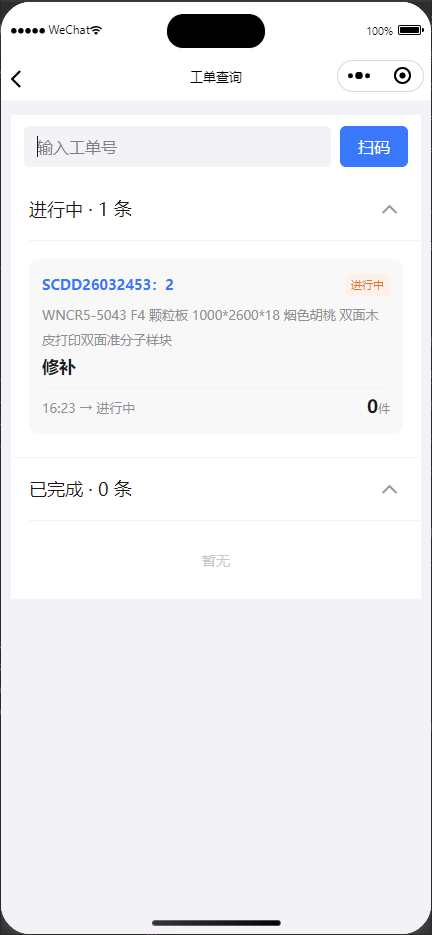

### 2. 查看工单信息

进入详情页后，顶部会显示工单基本信息：

- 工单号和行号
- 产品名称
- 产品编码
- 当前生产部门
- 计划数量
- 当前状态

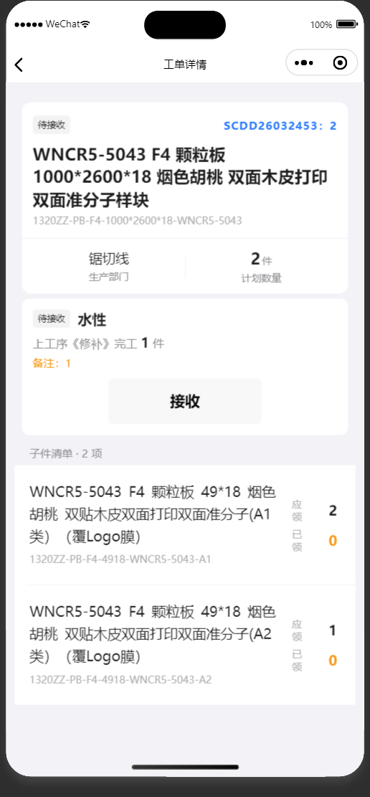

---

## 四、接收上道工序

如果当前工序不是第一道工序，需要先接收上道工序交过来的数量。

### 操作步骤

1. 在工单详情页确认当前工序。
2. 查看页面提示的上道工序完工数量。
3. 点击“接收”按钮。
4. 填写本次接收数量。
5. 上传接收/领用照片。
6. 选择接收人员。
7. 点击提交。


### 注意事项

- 接收数量由操作人员自己填写。
- 后续工序接收时必须拍照，用于材料领用或交接留底。
- 如果接收数量和可接收数量不一致，需要按页面提示填写原因。
- 人员选择时，不能只选择临时工，必须至少选择一名正式员工。

---

## 五、选择人员

开工、接收、返工等环节都需要选择人员。

### 人员类型

人员分为两类：

1. 正式员工  
   按部门分组，选择参与本次操作的员工。

2. 临时工  
   如果现场有临时工参与，可以按人数选择，例如临时工1、临时工2、临时工3。

### 操作要求

- 必须至少选择一名正式员工。
- 可以额外选择多个临时工。
- 不能只选择临时工。

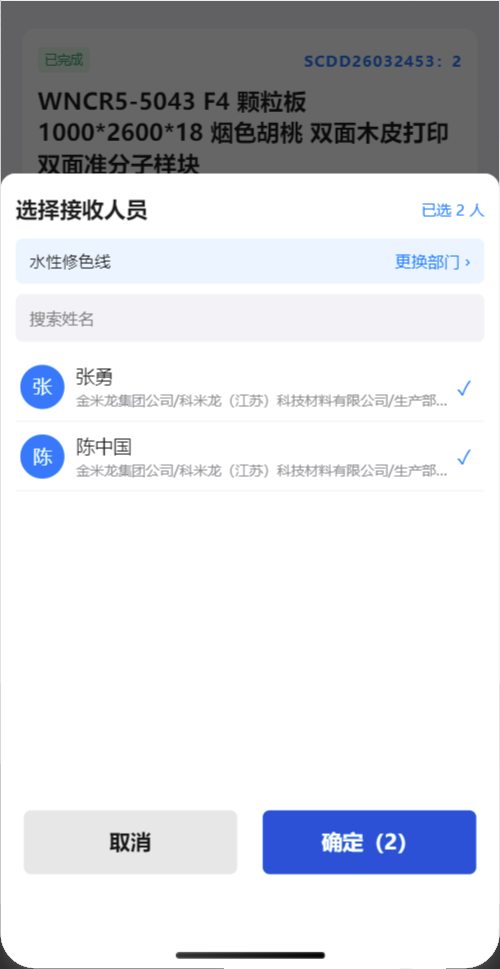

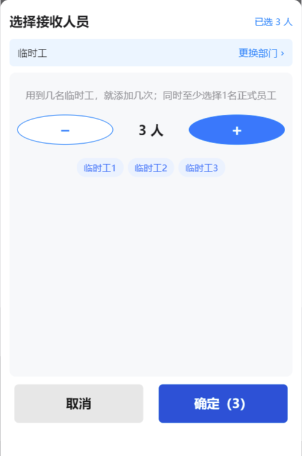

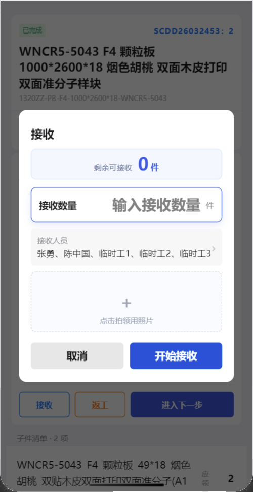

### 作用

系统会保存本次报工时选择的人员快照。后续即使人员离职、改部门，也不会影响历史记录。

---

## 六、开工

### 操作步骤

1. 确认当前工序名称。
2. 选择开工人员。
3. 点击“开工”。

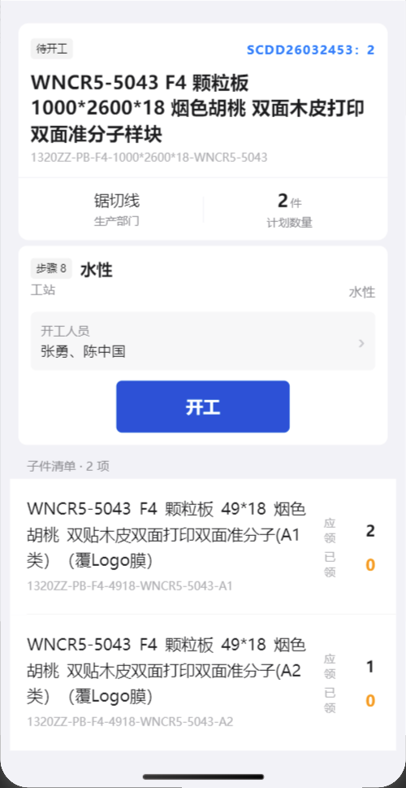

### 注意事项

- 同一工序开工后，不允许重复开工。
- 如果上一道工序还没有完成或还没有接收，当前工序不能开工。
- 第一工序没有上道接收，直接选择人员开工。

---

## 七、完工

当前工序完成后，需要点击“完工”提交数量。

### 操作步骤

1. 点击“完工”按钮。
2. 填写 A 级数量。
3. 填写 C 级数量。
4. 上传完工产品照片。
5. 如有异常或数量差异，填写说明。
6. 点击提交。

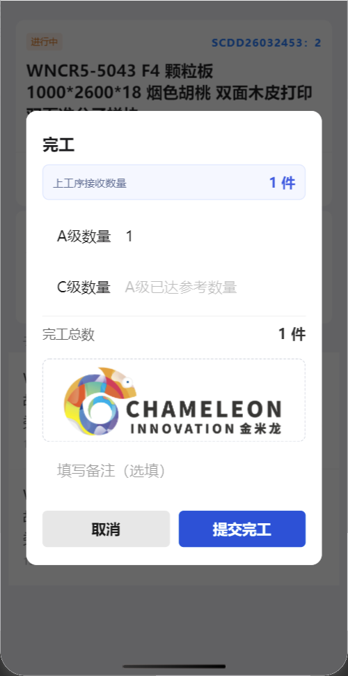

### 填写说明

- A 级数量：正常合格数量。
- C 级数量：需要返工或降级处理的数量。
- 完工产品照片：必须上传。
- 备注：正常情况可以不填；异常情况按页面提示填写。

### 完工后结果

- 如果还有下一道工序，系统会进入下一步流转。
- 如果已经是最后一道工序，工单会变为已完成。
- 完工记录中会显示开始时间、结束时间和用时。

---

## 八、接收完工

如果当前是接收作业，接收后还需要进行“接收完工”。

### 操作步骤

1. 点击“接收完工”。
2. 填写 A 级数量。
3. 填写 C 级数量。
4. 上传接收完工照片。
5. 点击确认完工。

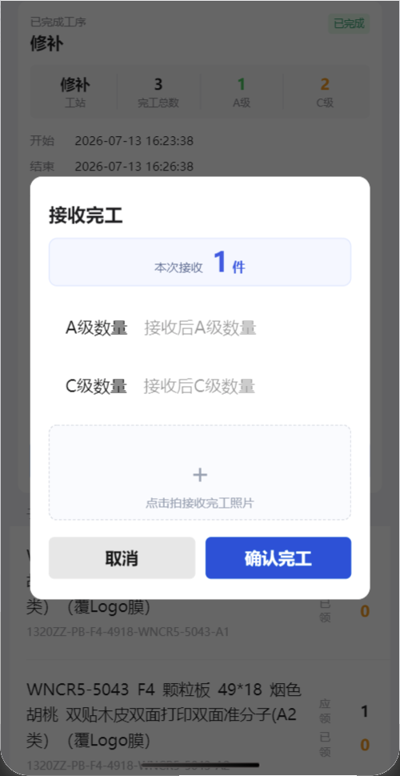

### 注意事项

- 接收完工也需要上传照片。
- 接收完工后，系统会更新当前工序的完工数量、A 级数量、C 级数量和结束时间。

---

## 九、返工

当完工记录中存在 C 级品时，可以发起返工。

### 返工开工

操作步骤：

1. 在完工记录详情中点击“返工”。
2. 填写返工数量。
3. 填写返工原因。
4. 选择返工人员。
5. 上传返工开工照片。
6. 点击开始返工。

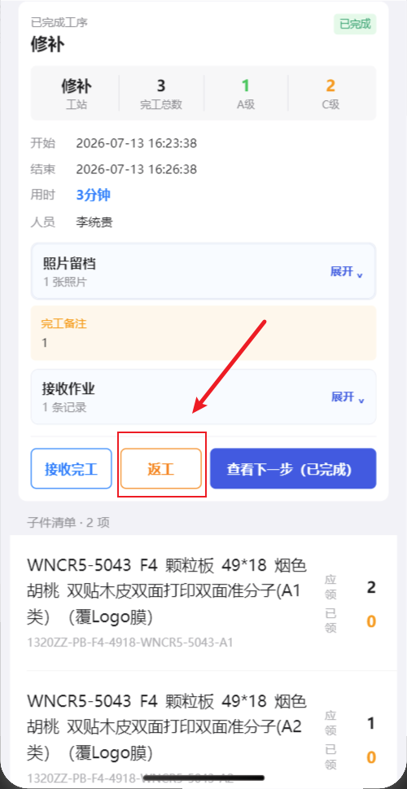

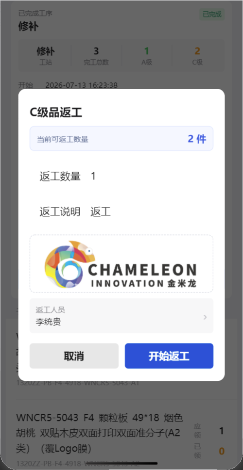

### 返工完工

操作步骤：

1. 返工完成后，再次进入该完工记录。
2. 点击“返工完工”。
3. 填写返工后的 A 级数量。
4. 填写返工后仍为 C 级的数量。
5. 上传返工完工照片。
6. 提交完工。

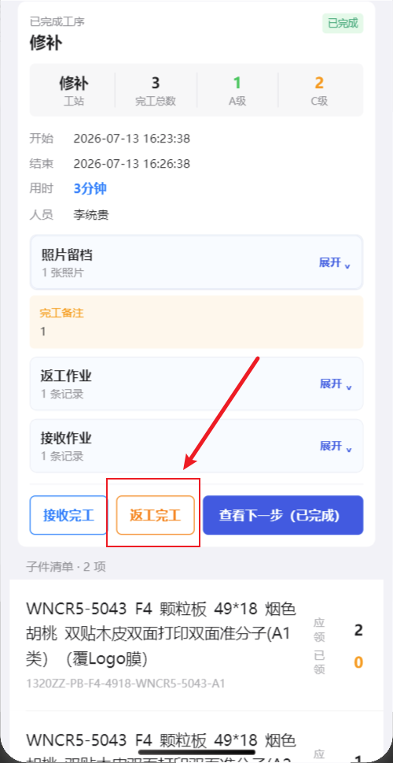

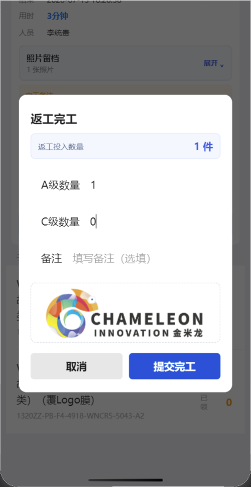

### 注意事项

- 返工对象是 C 级品。
- 返工数量不能超过当前可返工的 C 级数量。
- A 级数量 + C 级数量必须等于返工投入数量。
- 返工开工和返工完工都必须拍照。

---

## 十、查看历史记录

完工后，可以在完工记录详情中查看历史内容。

### 可查看内容

- 工序名称
- 完工总数
- A 级数量
- C 级数量
- 开始时间
- 结束时间
- 用时
- 人员
- 接收记录
- 返工记录
- 照片留档

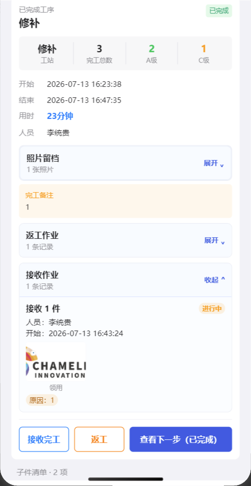

### 接收记录

接收记录会展示每次接收或接收完工的情况。

### 照片查看

所有记录中的照片都可以点击查看大图，包括：

- 主材照片
- 接收/领用照片
- 完工产品照片
- 接收完工照片
- 返工开工照片
- 返工完工照片

---

## 十一、进入下一步

如果当前工序已经完成，并且还有下一道工序，详情页会显示进入下一步相关按钮。

### 操作说明

1. 当前工序完工后，查看完工记录。
2. 点击“进入下一步”或“查看下一步”。
3. 下一道工序根据状态进行接收、开工或完工。

### 注意事项

- 有下一道工序时，不代表下一道工序已经开工。
- 下一道工序通常需要先接收上道工序交过来的数量。

---

## 十二、常见问题

| 问题 | 可能原因 | 处理方式 |
|---|---|---|
| 找不到工单 | 工单未指定路线，或已完成 | 联系管理人员检查工艺路线或工单状态 |
| 无法开工 | 上道工序未完成或未接收 | 等待上道工序完成，或先接收 |
| 接收数量不能提交 | 数量为空、为0，或超过可接收数量 | 检查数量，必要时填写原因 |
| 完工不能提交 | 未填写数量或未上传照片 | 填写 A/C 数量并上传完工产品照片 |
| 返工不能提交 | 返工数量超过可返工数量 | 按当前 C 级品可返工数量填写 |
| 只选临时工提交不了 | 系统要求必须有正式员工 | 至少选择一名正式员工 |
| 照片看不到 | 网络未加载或记录未上传成功 | 重新进入页面或检查网络 |

---

## 十三、现场操作要点

1. 每次开工、接收、返工都要确认人员。
2. 数量要按现场实际填写。
3. 接收、完工、返工相关照片必须拍清楚。
4. 有异常时要填写原因，方便后续追溯。
5. 完工后要检查 A 级、C 级数量是否正确。
6. 发现 C 级品需要返工时，通过返工功能单独记录。

---

## 十四、截图补充说明

本手册截图统一存放在：

`JML_MINIAPP/docs/工序报工操作手册截图/`

后续如果需要补充截图，可以继续按下面格式引用：

```markdown

```

说明：

- `JML_MINIAPP/docs/工序报工操作手册待替换截图/` 中的本次截图已复制到正式截图目录，手册正文统一引用正式目录。
